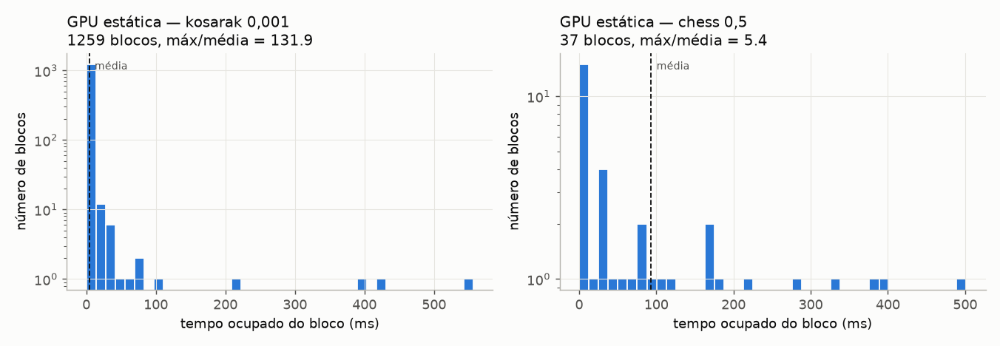

# Relatório — Fase 4: mineração estática na GPU

**Status:** concluída. Critérios de aceite atendidos.

## Resumo

Toda a mineração roda na GPU. Cada item frequente da árvore global é entregue a
um bloco de 256 threads, que resolve sozinho toda a recursão daquele item com
uma pilha explícita. As árvores condicionais são construídas pelo bloco com as
mesmas primitivas da Fase 3 (sort, LCP, scan, sparse table), em nível de bloco.

| Peça | Implementação |
| --- | --- |
| Memória por bloco | arena de ~24 MB com duas pontas (árvores por baixo, temporários por cima) |
| Histograma condicional | memória compartilhada (até 10 K itens), senão arena |
| Ordenação dos caminhos | merge sort de bloco por busca binária |
| Pais/contadores | sparse table em bloco (paralelo, sem thread única) |
| Caminho único | 2^L − 1 combinações geradas em paralelo |
| Saída | duas passadas; passada 2 em lotes se a saída não couber |
| Estouro de arena | projeção da base na GPU + árvore da Fase 3 + nova mineração |

## Corretude

| Teste | Resultado |
| --- | --- |
| 13 configurações reais (6 datasets) com `--debug` | 13/13 idênticas ao sequencial |
| Estouro forçado (arenas de 512 KB e 64 KB) | 9/9 idênticas; até 697 tarefas estouradas e reprocessadas |
| Alvo `tests` (inclui a mineração) | 535 verificações, 0 falhas |

## Desempenho da mineração (ms)

| Dataset | minsup | seq | GPU estática | ganho | máx/média por bloco |
| --- | --- | ---: | ---: | ---: | ---: |
| retail | 0,001 | 32 | 1,2 | **27×** | 6,0 |
| T10I4D100K | 0,001 | 68 | 4,0 | **17×** | 7,4 |
| kosarak | 0,001 | 1.119 | 1.008 | 1,1× | **131,9** |
| mushroom | 0,05 | 248 | 237 | 1,0× | 10,7 |
| accidents | 0,3 | 144 | 183 | 0,8× | 3,4 |
| chess | 0,5 | 228 | 876 | 0,26× | 5,4 |

## Leitura

- **Funciona bem quando há muitos itens com carga parecida** (esparsos).
- **Desbalanceamento**: em kosarak, 1.259 blocos terminam em poucos ms e um único
  bloco leva ~550 ms, que é o tempo do kernel inteiro.
- **Pouco paralelismo nos densos**: chess tem 37 itens → 37 blocos para 128 SMs,
  cada bloco processa milhares de árvores condicionais em série.
- As duas passadas dobram o custo da mineração (passada 1 ≈ metade do tempo).

Os três problemas são os que a fila dinâmica da Fase 5 deve atacar: dividir as
subárvores grandes entre blocos ociosos.
