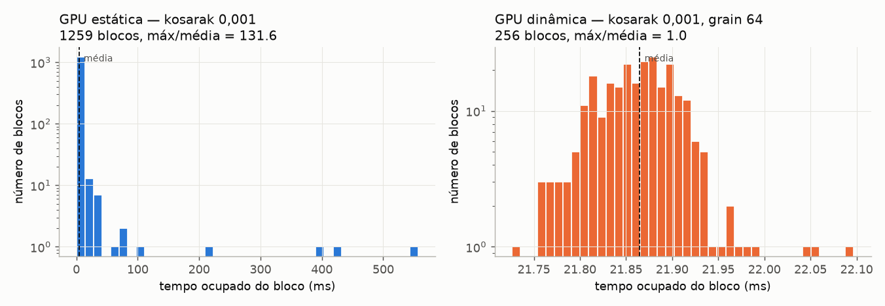

# Relatório — Fase 5: mineração dinâmica na GPU

**Status:** concluída. Critérios de aceite atendidos.

## Resumo

Os blocos deixam de ter posse fixa de um item. 256 blocos persistentes (2 por SM)
consomem uma fila global de tarefas; cada árvore condicional cuja base tem pelo
menos `grain` itens vira uma tarefa nova que qualquer bloco ocioso pode pegar.
Árvores menores são resolvidas pelo próprio bloco, em profundidade.

| Peça | Implementação |
| --- | --- |
| Fila | vetor circular, `head`/`tail` atômicos + nº de sequência por posição (MPMC sem travas) |
| Árvores enfileiradas | copiadas para um pool global com alocação por bump atômico |
| Terminação | contador `pending` (incrementado antes de publicar, decrementado ao concluir a subárvore) |
| Fila cheia / pool cheio | o bloco processa o filho localmente (degrada para a v1) |

## Corretude e robustez

| Teste | Resultado |
| --- | --- |
| 7 configurações × grain 0/256/4096 com `--debug` | 21/21 idênticas |
| Fila mínima, pool de 1 MB, arena de 512 KB (estouros) | 8/8 idênticas |
| **Estresse: 20 repetições × 21 configurações** | **420/420 sem deadlock e sem diferença** |
| Alvo `tests` | 535 verificações, 0 falhas |

## Desempenho da mineração (ms)

| Dataset | minsup | seq | estática | dinâmica (g=64) | din./est. | máx/média est. → din. |
| --- | --- | ---: | ---: | ---: | ---: | ---: |
| kosarak | 0,001 | 1.119 | 990,7 | **40,4** | 25× | 131,6 → 1,01 |
| chess | 0,5 | 228 | 884,5 | **27,8** | 32× | 5,4 → 1,09 |
| mushroom | 0,05 | 248 | 236,9 | **19,8** (8,1 com g=0) | 12× | 10,7 → 2,9 |
| accidents | 0,3 | 144 | 182,6 | **80,8** | 2,3× | 3,4 → 9,9 |
| T10I4D100K | 0,001 | 68 | 4,0 | **2,6** | 1,5× | 7,6 → 1,4 |
| retail | 0,001 | 32 | 1,2 | 1,5 | ≈ | 6,2 → 1,6 |

Na estática, kosarak tem 1.259 blocos quase todos abaixo de 10 ms e um de 550 ms;
na dinâmica, os 256 blocos ficam todos entre 21,7 e 22,1 ms.

## Efeito do grain

- **grain baixo (0–64)** é o melhor em quase tudo: muitas tarefas na fila, carga plana.
- **grain ≥ 1024** devolve o comportamento da estática (kosarak volta a 373–1.008 ms).
- Padrão alterado para **64**.

## Limitação conhecida

Em **accidents** a razão máx/média continua ~10: as árvores condicionais do
primeiro nível têm bases de centenas de milhares de caminhos, e a construção de
uma árvore é indivisível entre blocos. Uma saída seria mandar essas construções
para a rotina de grade inteira da Fase 3.
